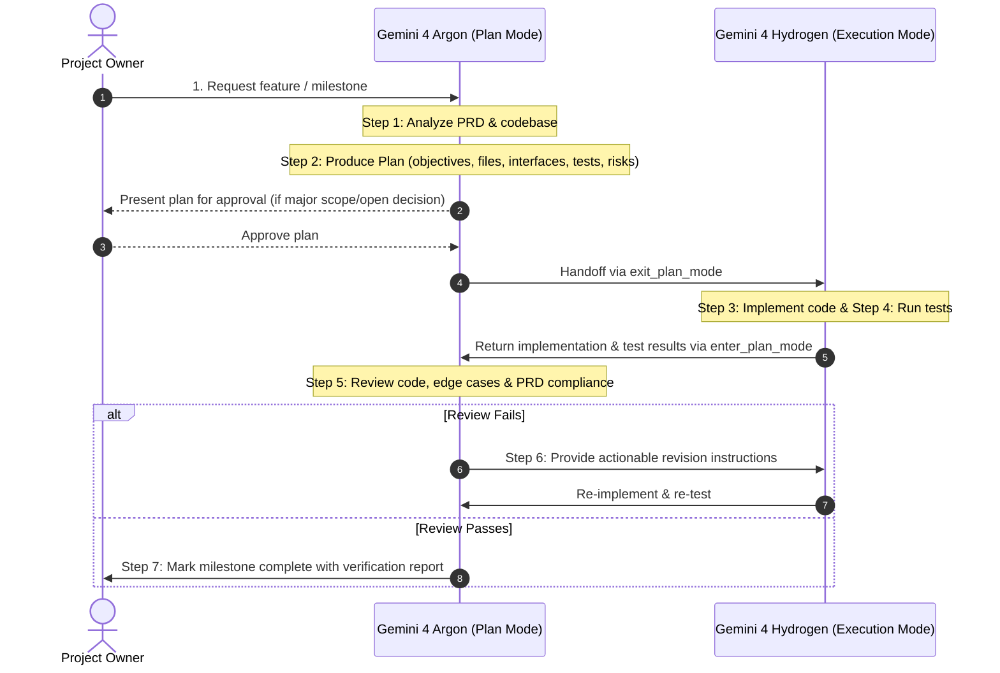

# AI Agent Orchestration Workflow — Purrfect Garden

> **Document Status:** Phase 0 Architecture Specification  
> **Primary Product Reference:** [PURRFECT_GARDEN_PRD.md](../PURRFECT_GARDEN_PRD.md)

---

## 1. Overview of the Two-Agent Architecture

Purrfect Garden uses a structured, role-separated development workflow built directly on the **Antigravity Orchestrator's native two-phase Plan/Execute architecture**. Instead of spawning fragile independent loops or relying on ad-hoc prompting, responsibilities are cleanly split between two specialized phases/roles overseen by the human Project Owner:

| Role | Antigravity Mode | Primary Mandate | Authority & Boundaries |
| :--- | :--- | :--- | :--- |
| **Gemini 4 Argon** *(Architect, Planner & Reviewer)* | **Plan Mode** | Analyze requirements, design system architecture, define module contracts, decompose tasks, and review implementations (`[plan review]`). | Cannot write production code blindly without planning. Rejects incomplete or non-compliant work. Proposes balancing defaults clearly labeled as unapproved until confirmed. |
| **Gemini 4 Hydrogen** *(Implementation & Execution Worker)* | **Execution Mode** | Implement features strictly per Argon's blueprint, write UI/domain/database code, author unit/integration tests, run builds/tests, and report results. | Cannot unilaterally introduce major architectural changes, skip tests, or invent unapproved product features. Must hand back via `enter_plan_mode` if an assumption breaks or ambiguity arises. |
| **Human Project Owner** *(Product Lead)* | **Decision Authority** | Approve architecture, confirm open product/balancing decisions, authorize phase transitions, and approve Git commits/pushes. | Retains final authority over scope, design trade-offs, and releases. |

---

## 2. How Antigravity Orchestrator Coordinates Argon and Hydrogen

The platform natively supports the **Argon ↔ Hydrogen** handoff within a shared conversation context so zero architectural knowledge is lost between planning and implementation:

1. **Argon Starts in Plan Mode:** When a user request or new feature begins, Argon inspects the codebase (read-only), cross-references `docs/PURRFECT_GARDEN_PRD.md` and `docs/architecture/*`, and produces a concrete, self-contained execution plan.
2. **Handoff to Hydrogen (`exit_plan_mode`):** Once the plan (or milestone blueprint) is ready—and approved by the Project Owner when required—Argon invokes `exit_plan_mode` with the exact step-by-step specification, file paths, interfaces, and verification commands.
3. **Hydrogen Executes in Execution Mode:** Hydrogen receives the approved plan as its operating blueprint. It creates/edits files, runs Vitest/typecheck/build commands, and verifies every acceptance criterion.
4. **Escalation & Plan Review (`enter_plan_mode`):**
   - If a verification check fails twice, a plan assumption does not hold, or an architectural decision is missing, Hydrogen stops immediately and invokes `enter_plan_mode` with exact findings.
   - At periodic checkpoints (`[plan review due]`) or feature completion, Hydrogen hands back to Argon for formal review.
5. **Argon Reviews & Completes:** Argon inspects the diff, test output, and PRD alignment before reporting completion to the Project Owner.

---

## 3. The 7-Step Feature Development Lifecycle

Every significant feature or milestone follows this mandatory 7-step lifecycle:

### Step-by-Step Quality Gates

1. **Step 1 — Analyze (Argon):**
   - Inspect existing files and dependencies.
   - Cross-check PRD sections, acceptance criteria, and any related open decisions (PRD Section 20).
2. **Step 2 — Plan (Argon):**
   - Produce a blueprint containing:
     - Feature objectives.
     - Technical approach & module boundaries.
     - Exact files to create or modify.
     - Dependencies & database migration impacts.
     - Concrete acceptance criteria & verification commands.
     - Potential edge cases and risks.
3. **Step 3 — Implement (Hydrogen):**
   - Follow Argon's approved interfaces and directory structure.
   - Keep business logic decoupled from React UI components.
   - Place configurable balancing numbers in `src/shared/config/balanceConfig.ts`.
4. **Step 4 — Test (Hydrogen):**
   - Write or update Vitest unit/integration tests for all new domain/persistence logic.
   - Execute TypeScript typechecking (`tsc --noEmit`), tests (`npm test`), and build verification.
   - Record exact commands run and raw outputs (never fabricate or extrapolate results).
5. **Step 5 — Review (Argon):**
   - Verify strict PRD compliance (e.g., no phantom offline focus time, no prohibited features).
   - Check module coupling, transaction safety, edge-case coverage, and potential regressions.
   - Argon **must not** blindly rubber-stamp Hydrogen's output.
6. **Step 6 — Revise (Hydrogen under Argon guidance):**
   - If review fails, Argon writes a targeted revision plan specifying exact defects and expected fixes; Hydrogen resolves and re-runs tests.
7. **Step 7 — Complete (Argon → Project Owner):**
   - Mark the milestone complete only when all acceptance criteria pass and verified outputs are observed.

---

## 4. Non-Negotiable Architectural & Product Guardrails

Both Argon and Hydrogen must enforce these constraints on every task:

### 4.1. Focus & Time Integrity Guardrails
- **Focus comes first:** Timer reliability, accuracy, and persistence always outrank decorative features.
- **Explicit start/stop only:** Never infer focus from keyboard/mouse activity or background OS activity.
- **Monotonic timing:** Active timers must derive elapsed time from monotonic timestamps, never from UI render frames or naive `setInterval` counters.
- **App exit & OS suspend behavior:** Closing the app or putting the OS to sleep while a session is running must **pause** the session and persist elapsed state. Reopening restores the session as **paused**. Time elapsed while the app is closed must **never** be counted.
- **Break exclusion:** Break phases must never count toward focus totals, XP grants, focus goals, or daily streak minutes.

### 4.2. Game Scope & Content Guardrails
- **Cozy diorama, not an RPG:** Keep the garden 2D isometric pixel art with drag/place customization. **Do not** introduce player character movement (WASD), combat, complex farming automation, crop selling, or player-to-player trading.
- **Strict initial pet roster:** Only **Cats, Dogs, and Capybaras** are allowed. **Do not** add Bears in the initial release.
- **Non-destructive garden expansion:** Unlocking or switching garden areas must preserve all previous garden areas and their saved layouts.
- **Zero monetization:** No real-money purchases, microtransactions, or pay-to-win mechanics. Gacha uses earned in-app tickets/currency only.
- **Asset copyright safety:** Use only original, public-domain, or properly licensed pixel-art and audio assets. Never copy Stardew Valley assets or copyrighted commercial music. The app must work cleanly even if optional audio assets are absent.

### 4.3. Engineering & Repository Guardrails
- **Data-driven balancing:** Never hardcode unfinalized XP rates, item costs, gacha probabilities, streak thresholds, or goal templates inside business logic or UI components. Keep them centralized in `src/shared/config/balanceConfig.ts` (or seed data tables).
- **Atomic transactions:** All multi-record mutations (e.g., completing a session + updating daily activity + granting XP; spending XP + granting inventory item) must run inside SQLite transactions.
- **No unauthorized Git or destructive file actions:** Never overwrite or delete existing user files without confirmation, and never run `git commit`, `git push`, or publish changes without explicit authorization from the Project Owner.

