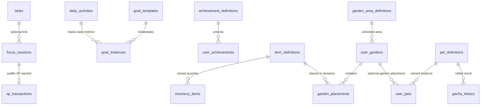

# Database Design & Local Persistence Strategy — Purrfect Garden

> **Document Status:** Phase 0 Architecture Specification  
> **Primary Product Reference:** [PURRFECT_GARDEN_PRD.md](../PURRFECT_GARDEN_PRD.md)

---

## 1. Local Persistence Strategy

### 1.1. Database Engine & File Location
- **Engine:** Embedded **SQLite 3** (`better-sqlite3` in Electron Main Process).
- **Storage Path:** `path.join(app.getPath('userData'), 'purrfect_garden.db')` (on Windows: `%APPDATA%\Purrfect Garden\purrfect_garden.db`).
- **Connection Pragmas (Applied at startup):**
  ```sql
  PRAGMA journal_mode = WAL;
  PRAGMA synchronous = NORMAL;
  PRAGMA foreign_keys = ON;
  PRAGMA busy_timeout = 5000;
  ```
- **Migrations:** Forward-only numbered SQL files (`001_initial_schema.sql`, `002_...`) tracked inside `schema_migrations`.

### 1.2. Timezone & Local Calendar Boundary Strategy
- All exact timestamps (`started_at`, `ended_at`, `created_at`) are stored in **ISO-8601 UTC** strings (`YYYY-MM-DDTHH:mm:ss.sssZ`).
- All daily boundaries (`daily_activities.date_key`, `streak_state`, `goal_instances.period_key`) are computed using the user's **local calendar date** at the time of recording (`YYYY-MM-DD`, or `YYYY-Www` for weekly periods), ensuring streaks and daily goals reset accurately at local midnight (PRD Section 8.1 & 16).

### 1.3. Future Cloud Synchronization Readiness
- Primary keys use stable **UUIDv4 strings** (`TEXT PRIMARY KEY`) instead of auto-incrementing integers for user-created entities (`focus_sessions`, `tasks`, `xp_transactions`, `garden_placements`, `user_pets`).
- Core user tables include `updated_at` timestamps to enable future conflict detection or delta syncing without refactoring existing local schemas.

---

## 2. Entity-Relationship Overview



---

## 3. Initial SQLite Schema Specification (DDL)

### 3.1. Migrations & Application Settings

```sql
CREATE TABLE IF NOT EXISTS schema_migrations (
    version INTEGER PRIMARY KEY,
    name TEXT NOT NULL,
    applied_at TEXT NOT NULL
);

CREATE TABLE IF NOT EXISTS app_settings (
    key TEXT PRIMARY KEY,
    value_json TEXT NOT NULL,
    updated_at TEXT NOT NULL
);

CREATE TABLE IF NOT EXISTS timer_preferences (
    id INTEGER PRIMARY KEY CHECK (id = 1),
    default_mode TEXT NOT NULL DEFAULT 'pomodoro' CHECK (default_mode IN ('pomodoro', 'stopwatch', 'custom')),
    pomodoro_work_minutes INTEGER NOT NULL DEFAULT 25 CHECK (pomodoro_work_minutes > 0),
    pomodoro_short_break_minutes INTEGER NOT NULL DEFAULT 5 CHECK (pomodoro_short_break_minutes > 0),
    pomodoro_long_break_minutes INTEGER NOT NULL DEFAULT 15 CHECK (pomodoro_long_break_minutes > 0),
    pomodoro_cycles_before_long_break INTEGER NOT NULL DEFAULT 4 CHECK (pomodoro_cycles_before_long_break > 0),
    auto_start_breaks INTEGER NOT NULL DEFAULT 0 CHECK (auto_start_breaks IN (0, 1)),
    auto_start_work INTEGER NOT NULL DEFAULT 0 CHECK (auto_start_work IN (0, 1)),
    custom_default_minutes INTEGER NOT NULL DEFAULT 30 CHECK (custom_default_minutes > 0),
    sound_on_complete INTEGER NOT NULL DEFAULT 1 CHECK (sound_on_complete IN (0, 1)),
    updated_at TEXT NOT NULL
);

CREATE TABLE IF NOT EXISTS music_preferences (
    id INTEGER PRIMARY KEY CHECK (id = 1),
    active_playlist_id TEXT,
    master_volume REAL NOT NULL DEFAULT 0.7 CHECK (master_volume BETWEEN 0.0 AND 1.0),
    shuffle_enabled INTEGER NOT NULL DEFAULT 0 CHECK (shuffle_enabled IN (0, 1)),
    fade_out_on_session_end INTEGER NOT NULL DEFAULT 1 CHECK (fade_out_on_session_end IN (0, 1)),
    ambience_mix_json TEXT NOT NULL DEFAULT '{}', -- e.g. {"rain":0.4,"fireplace":0.2}
    favorite_track_ids_json TEXT NOT NULL DEFAULT '[]',
    updated_at TEXT NOT NULL
);
```

### 3.2. Focus & Task Tracking (Highest Priority)

```sql
CREATE TABLE IF NOT EXISTS tasks (
    id TEXT PRIMARY KEY,
    title TEXT NOT NULL,
    notes TEXT DEFAULT '',
    category TEXT NOT NULL DEFAULT 'Study',
    priority TEXT NOT NULL DEFAULT 'medium' CHECK (priority IN ('low', 'medium', 'high')),
    estimated_minutes INTEGER CHECK (estimated_minutes IS NULL OR estimated_minutes > 0),
    deadline_at TEXT,
    is_completed INTEGER NOT NULL DEFAULT 0 CHECK (is_completed IN (0, 1)),
    completed_at TEXT,
    created_at TEXT NOT NULL,
    updated_at TEXT NOT NULL
);

CREATE TABLE IF NOT EXISTS focus_sessions (
    id TEXT PRIMARY KEY,
    mode TEXT NOT NULL CHECK (mode IN ('pomodoro', 'stopwatch', 'custom')),
    phase TEXT NOT NULL CHECK (phase IN ('focus', 'short_break', 'long_break')),
    status TEXT NOT NULL CHECK (status IN ('active', 'paused', 'completed', 'stopped', 'interrupted')),
    target_seconds INTEGER,
    recorded_seconds INTEGER NOT NULL DEFAULT 0 CHECK (recorded_seconds >= 0),
    last_checkpoint_seconds INTEGER NOT NULL DEFAULT 0 CHECK (last_checkpoint_seconds >= 0),
    task_id TEXT REFERENCES tasks(id) ON DELETE SET NULL,
    local_date TEXT NOT NULL, -- YYYY-MM-DD in user's local timezone at session start/save
    started_at TEXT NOT NULL,
    ended_at TEXT,
    xp_awarded INTEGER NOT NULL DEFAULT 0 CHECK (xp_awarded >= 0),
    updated_at TEXT NOT NULL
);

CREATE INDEX IF NOT EXISTS idx_focus_sessions_local_date ON focus_sessions(local_date);
CREATE INDEX IF NOT EXISTS idx_focus_sessions_status ON focus_sessions(status);
CREATE INDEX IF NOT EXISTS idx_focus_sessions_task_id ON focus_sessions(task_id);
```

### 3.3. Daily Activity, Goals & Streaks

```sql
CREATE TABLE IF NOT EXISTS daily_activities (
    local_date TEXT PRIMARY KEY, -- YYYY-MM-DD
    valid_focus_seconds INTEGER NOT NULL DEFAULT 0 CHECK (valid_focus_seconds >= 0),
    completed_sessions_count INTEGER NOT NULL DEFAULT 0 CHECK (completed_sessions_count >= 0),
    completed_tasks_count INTEGER NOT NULL DEFAULT 0 CHECK (completed_tasks_count >= 0),
    streak_qualified INTEGER NOT NULL DEFAULT 0 CHECK (streak_qualified IN (0, 1)),
    updated_at TEXT NOT NULL
);

CREATE TABLE IF NOT EXISTS streak_state (
    id INTEGER PRIMARY KEY CHECK (id = 1),
    current_streak INTEGER NOT NULL DEFAULT 0 CHECK (current_streak >= 0),
    longest_streak INTEGER NOT NULL DEFAULT 0 CHECK (longest_streak >= 0),
    last_qualified_date TEXT, -- YYYY-MM-DD
    streak_freezes_owned INTEGER NOT NULL DEFAULT 0 CHECK (streak_freezes_owned >= 0),
    updated_at TEXT NOT NULL
);

CREATE TABLE IF NOT EXISTS goal_templates (
    id TEXT PRIMARY KEY,
    period_type TEXT NOT NULL CHECK (period_type IN ('daily', 'weekly')),
    metric_type TEXT NOT NULL CHECK (metric_type IN ('focus_minutes', 'focus_sessions', 'tasks_completed', 'single_session_minutes')),
    title TEXT NOT NULL,
    target_value INTEGER NOT NULL CHECK (target_value > 0),
    reward_xp INTEGER NOT NULL DEFAULT 0 CHECK (reward_xp >= 0),
    reward_item_id TEXT,
    is_active INTEGER NOT NULL DEFAULT 1 CHECK (is_active IN (0, 1))
);

CREATE TABLE IF NOT EXISTS goal_instances (
    id TEXT PRIMARY KEY,
    template_id TEXT NOT NULL REFERENCES goal_templates(id),
    period_type TEXT NOT NULL CHECK (period_type IN ('daily', 'weekly')),
    period_key TEXT NOT NULL, -- YYYY-MM-DD (daily) or YYYY-Www (weekly)
    target_value INTEGER NOT NULL CHECK (target_value > 0),
    current_value INTEGER NOT NULL DEFAULT 0 CHECK (current_value >= 0),
    is_completed INTEGER NOT NULL DEFAULT 0 CHECK (is_completed IN (0, 1)),
    reward_claimed INTEGER NOT NULL DEFAULT 0 CHECK (reward_claimed IN (0, 1)),
    completed_at TEXT,
    UNIQUE (template_id, period_key)
);
```

### 3.4. Achievements, XP Ledger & Inventory

```sql
CREATE TABLE IF NOT EXISTS achievement_definitions (
    id TEXT PRIMARY KEY,
    category TEXT NOT NULL CHECK (category IN (
        'focus_master', 'consistency', 'green_thumb', 'explorer',
        'collector', 'pet_lover', 'early_bird', 'night_owl'
    )),
    tier TEXT NOT NULL CHECK (tier IN ('bronze', 'silver', 'gold')),
    name TEXT NOT NULL,
    description TEXT NOT NULL,
    target_value INTEGER NOT NULL CHECK (target_value > 0),
    reward_xp INTEGER NOT NULL DEFAULT 0,
    reward_tickets INTEGER NOT NULL DEFAULT 0,
    icon_key TEXT NOT NULL
);

CREATE TABLE IF NOT EXISTS user_achievements (
    achievement_id TEXT PRIMARY KEY REFERENCES achievement_definitions(id),
    progress_value INTEGER NOT NULL DEFAULT 0 CHECK (progress_value >= 0),
    is_unlocked INTEGER NOT NULL DEFAULT 0 CHECK (is_unlocked IN (0, 1)),
    unlocked_at TEXT,
    is_viewed INTEGER NOT NULL DEFAULT 0 CHECK (is_viewed IN (0, 1)),
    reward_claimed INTEGER NOT NULL DEFAULT 0 CHECK (reward_claimed IN (0, 1))
);

CREATE TABLE IF NOT EXISTS xp_transactions (
    id TEXT PRIMARY KEY,
    delta_xp INTEGER NOT NULL, -- positive for earn, negative for spend
    balance_after INTEGER NOT NULL CHECK (balance_after >= 0),
    source_type TEXT NOT NULL CHECK (source_type IN (
        'focus_session', 'goal_reward', 'streak_milestone',
        'achievement_reward', 'shop_purchase', 'gacha_roll', 'adjustment'
    )),
    reference_id TEXT, -- sessionId, goalInstanceId, itemId, etc.
    description TEXT NOT NULL,
    created_at TEXT NOT NULL
);

CREATE UNIQUE INDEX IF NOT EXISTS idx_xp_unique_onetime_reward
    ON xp_transactions(source_type, reference_id)
    WHERE source_type IN ('goal_reward', 'streak_milestone', 'achievement_reward') AND reference_id IS NOT NULL;

CREATE TABLE IF NOT EXISTS item_definitions (
    id TEXT PRIMARY KEY,
    category TEXT NOT NULL CHECK (category IN ('plant', 'seed', 'tool', 'technology', 'decor', 'ticket')),
    name TEXT NOT NULL,
    description TEXT NOT NULL,
    rarity TEXT NOT NULL DEFAULT 'common' CHECK (rarity IN ('common', 'uncommon', 'rare', 'epic')),
    xp_cost INTEGER CHECK (xp_cost IS NULL OR xp_cost >= 0),
    sprite_key TEXT NOT NULL,
    tile_width INTEGER NOT NULL DEFAULT 1,
    tile_height INTEGER NOT NULL DEFAULT 1,
    is_placeable INTEGER NOT NULL DEFAULT 1 CHECK (is_placeable IN (0, 1))
);

CREATE TABLE IF NOT EXISTS inventory_items (
    item_id TEXT PRIMARY KEY REFERENCES item_definitions(id),
    quantity INTEGER NOT NULL DEFAULT 0 CHECK (quantity >= 0),
    first_acquired_at TEXT NOT NULL,
    updated_at TEXT NOT NULL
);
```

### 3.5. Garden Areas & Placements

```sql
CREATE TABLE IF NOT EXISTS garden_area_definitions (
    id TEXT PRIMARY KEY,
    name TEXT NOT NULL,
    theme TEXT NOT NULL,
    description TEXT NOT NULL,
    grid_width INTEGER NOT NULL DEFAULT 12 CHECK (grid_width > 0),
    grid_height INTEGER NOT NULL DEFAULT 12 CHECK (grid_height > 0),
    unlock_xp_cost INTEGER,
    unlock_condition_key TEXT
);

CREATE TABLE IF NOT EXISTS user_gardens (
    id TEXT PRIMARY KEY,
    area_definition_id TEXT NOT NULL UNIQUE REFERENCES garden_area_definitions(id),
    custom_name TEXT NOT NULL,
    is_unlocked INTEGER NOT NULL DEFAULT 0 CHECK (is_unlocked IN (0, 1)),
    unlocked_at TEXT,
    is_active_view INTEGER NOT NULL DEFAULT 0 CHECK (is_active_view IN (0, 1))
);

CREATE TABLE IF NOT EXISTS garden_placements (
    id TEXT PRIMARY KEY,
    garden_id TEXT NOT NULL REFERENCES user_gardens(id) ON DELETE CASCADE,
    item_id TEXT NOT NULL REFERENCES item_definitions(id),
    tile_x INTEGER NOT NULL CHECK (tile_x >= 0),
    tile_y INTEGER NOT NULL CHECK (tile_y >= 0),
    rotation INTEGER NOT NULL DEFAULT 0,
    placed_at TEXT NOT NULL,
    UNIQUE (garden_id, tile_x, tile_y)
);
```

### 3.6. Pets & Gacha System

```sql
CREATE TABLE IF NOT EXISTS pet_definitions (
    id TEXT PRIMARY KEY,
    species TEXT NOT NULL CHECK (species IN ('cat', 'dog', 'capybara')), -- Strictly no bears
    name TEXT NOT NULL,
    rarity TEXT NOT NULL CHECK (rarity IN ('common', 'rare', 'epic', 'legendary')),
    description TEXT NOT NULL,
    sprite_key TEXT NOT NULL,
    gacha_weight INTEGER NOT NULL DEFAULT 1 CHECK (gacha_weight > 0)
);

CREATE TABLE IF NOT EXISTS user_pets (
    id TEXT PRIMARY KEY,
    pet_definition_id TEXT NOT NULL REFERENCES pet_definitions(id),
    nickname TEXT,
    duplicate_count INTEGER NOT NULL DEFAULT 1 CHECK (duplicate_count >= 1),
    placed_garden_id TEXT REFERENCES user_gardens(id) ON DELETE SET NULL,
    tile_x INTEGER,
    tile_y INTEGER,
    acquired_at TEXT NOT NULL,
    UNIQUE (pet_definition_id)
);

CREATE TABLE IF NOT EXISTS gacha_history (
    id TEXT PRIMARY KEY,
    currency_type TEXT NOT NULL CHECK (currency_type IN ('ticket', 'xp')),
    currency_spent INTEGER NOT NULL CHECK (currency_spent >= 0),
    pet_definition_id TEXT NOT NULL REFERENCES pet_definitions(id),
    was_duplicate INTEGER NOT NULL CHECK (was_duplicate IN (0, 1)),
    pity_counter_after INTEGER NOT NULL CHECK (pity_counter_after >= 0),
    created_at TEXT NOT NULL
);
```

---

## 4. Critical Transactional Workflows

Every multi-step mutation executes inside a synchronous `better-sqlite3` transaction (`db.transaction(() => { ... })()`):

1. **Completing / Stopping a Valid Focus Session:**
   - Reject if `phase !== 'focus'` (break sessions are logged for history only without XP/streak).
   - Update `focus_sessions` (`status = 'completed' | 'stopped'`, `ended_at`, `recorded_seconds`).
   - Upsert `daily_activities` for `local_date`: add `valid_focus_seconds`, increment `completed_sessions_count`.
   - Evaluate `streak_state`: if `valid_focus_seconds >= config.streakMinimumSeconds` (default `1200`s = 20m) and `streak_qualified == 0`, mark `streak_qualified = 1` and recalculate `current_streak` / `longest_streak`.
   - Update matching active `goal_instances`; if `current_value >= target_value` and `reward_claimed == 0`, mark `is_completed = 1`, set `reward_claimed = 1`, and issue XP/item reward.
   - Calculate session XP from `balanceConfig`, read current balance, insert positive `xp_transactions` row.
   - Evaluate relevant `achievement_definitions`.

2. **Exchanging XP for Garden Items:**
   - Read item price from `item_definitions`.
   - Compute current balance from the latest `xp_transactions.balance_after` (or `0` if empty).
   - Throw `InsufficientXPError` if `currentBalance < totalCost`.
   - Insert negative `xp_transactions` row (`balance_after = currentBalance - totalCost`).
   - Upsert `inventory_items` (`quantity = quantity + purchaseQuantity`).

3. **Placing & Removing Garden Items:**
   - **Place:** Verify `inventory_items.quantity > placedCount` in `garden_placements`; verify tile `(tile_x, tile_y)` is within `garden_area_definitions` bounds and unoccupied; insert into `garden_placements`.
   - **Remove:** Delete row from `garden_placements` (item automatically becomes available in inventory again without losing ownership).

