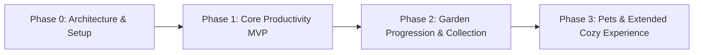

# Development Roadmap & Open Decisions — Purrfect Garden

> **Document Status:** Phase 0 Architecture Specification  
> **Primary Product Reference:** [PURRFECT_GARDEN_PRD.md](../PURRFECT_GARDEN_PRD.md)

---

## 1. Phased Implementation Plan

Development strictly follows the phased roadmap in PRD Section 18. **Focus reliability and local data integrity must never be delayed by decorative or game-related features.**

---

## 2. Detailed Milestone Breakdown

### Phase 0 — Architecture and Setup *(Current Phase)*
- **M0.1: Architecture & Agent Workflow Blueprint**
  - Repository audit & PRD analysis.
  - Documentation suite in `docs/architecture/` (`AGENT_WORKFLOW.md`, `TECH_STACK.md`, `SYSTEM_ARCHITECTURE.md`, `DATABASE_DESIGN.md`, `DEVELOPMENT_ROADMAP.md`).
  - **Gate:** Project Owner approval of proposed tech stack, database schema, and defaults.

---

### Phase 1 — Core Productivity MVP *(Highest Priority)*

| Milestone | Scope & Deliverables | Verification & Test Targets |
| :--- | :--- | :--- |
| **M1.1: Desktop Shell & Persistence Foundation** | Initialize `electron-vite` + React 19 + TypeScript + Tailwind CSS + `better-sqlite3` (WAL mode) + SQL migrator + typed `contextBridge` + Left Sidebar navigation + Cozy theme tokens + `balanceConfig.ts`. | `npm run build` succeeds; SQLite creates DB and applies `001_initial.sql`; all 10 navigation sections render cleanly. |
| **M1.2: Authoritative Focus Timer & Recovery** | Implement `TimerSupervisor` in Main process: Pomodoro (work/short break/long break), Stopwatch, Custom Countdown; monotonic elapsed time; `powerMonitor` & `before-quit` synchronous pause; startup session recovery modal/banner. | Vitest suite verifies: state transitions, break exclusion from focus stats, monotonic timing without drift, and app-exit pause + restart recovery with zero offline time added. |
| **M1.3: Focus History & Statistics** | Implement `FocusSessionService`: Today's total, all-time total, daily/weekly/monthly summaries, average session duration, session history list, calendar activity heatmap. | Integration tests with `:memory:` SQLite verify local date boundary grouping and break-time exclusion. |
| **M1.4: Task Management & Session Linking** | Implement `TaskService` & `TasksView`: Create/Edit/Delete/Complete tasks, priority (Low/Med/High), categories, optional deadline & estimate, filter tabs (Today/Incomplete/Completed/Overdue), link task to focus session before or after completion. | Unit + SQLite tests for CRUD, completion timestamps, and task-linked time aggregation. |
| **M1.5: Daily Goals & Streak Tracking** | Implement `StreakService` & `GoalService`: 20-min configurable local calendar day streak rule, current & longest streak tracking, daily goal instances with idempotent reward claiming. | Vitest tests verify local midnight rollover, consecutive vs. missed day streak reset, and prevention of double reward claims. |
| **M1.6: Cozy Music & Ambient Sound Mixer** | Implement `audioEngine.ts` (Howler.js / Web Audio): bottom music bar, playlist selector, multi-layer ambient mixer (Lo-fi, Rain, Fireplace, Forest, Ocean Waves), favorite toggles, optional fade-out on timer completion. App works gracefully if audio files are missing. | Manual + unit tests verify persisted preferences and graceful fallback when audio assets are absent. |
| **M1.7: Basic 2D Isometric Garden & Compact Timer** | Implement starter garden diorama canvas (2:1 isometric grid, integer scaling, crisp pixel rendering), basic starter items placement/move/remove persisted in SQLite, and **right-docked Compact Timer Panel** inside Garden view. | Garden layout persists across app restarts; user can start/pause/stop the timer directly from Garden view. |

---

### Phase 2 — Garden Progression & Collection

| Milestone | Scope & Deliverables | Verification & Test Targets |
| :--- | :--- | :--- |
| **M2.1: XP Economy & Audit Ledger** | `ProgressionService` implementing atomic `xp_transactions` grants from focus/goals and catalog purchases with `balance_after >= 0` enforcement. | Integration tests prove negative balances and duplicate one-time rewards are impossible. |
| **M2.2: Catalog, Seeds, Plants, Tools & Tech** | Data-driven `item_definitions` catalog (seeds, plants, tools, technologies), Inventory view, and exchange shop showing clear XP costs. | Purchases update `inventory_items` and `xp_transactions` atomically. |
| **M2.3: Multi-Area Garden Customization** | Multiple unlockable garden areas (`garden_area_definitions`), garden switcher preserving independent layouts, full placement/removal ergonomics. | Switching/unlocking areas never overwrites or deletes existing placements in prior gardens. |
| **M2.4: Achievements & Collection Journal** | 8 PRD achievement categories (Bronze/Silver/Gold tiers), unviewed badge notifications, Collection & Journal screen showing discovery dates and unlock sources. | Tests verify one-time unlock rules across all achievement categories. |
| **M2.5: Weekly Goals & Richer Analytics** | Weekly goal pool (`YYYY-Www` period keys), task-based focus breakdown charts. | Weekly rollover and goal template rotation tests pass. |

---

### Phase 3 — Pets & Extended Cozy Experience

| Milestone | Scope & Deliverables | Verification & Test Targets |
| :--- | :--- | :--- |
| **M3.1: Pet System & Album** | Catalog and collection album strictly scoped to **Cats, Dogs, and Capybaras** (no Bears), rarity tiers, and pet details. | Schema check & tests verify no prohibited species exist. |
| **M3.2: In-App Gacha System** | Gacha rolls using earned tickets/XP (zero real money), transparent probability table display, pity counter, and duplicate count handling. | Statistical/unit tests verify pity guarantee and deterministic ledger recording. |
| **M3.3: Pets in Garden, Ambient Mode & Themes** | Place owned pets onto valid isometric garden tiles with idle animations; enhanced Fullscreen Ambient Focus Mode; additional seasonal garden visuals. | Full end-to-end Phase 1–3 acceptance walkthrough passes. |

---

## 3. Open Decisions Requiring Confirmation (PRD Section 20)

Per PRD Section 20, the following unfinalized parameters will be stored in `src/shared/config/balanceConfig.ts` (never hardcoded into logic) with these **proposed initial defaults** awaiting Project Owner sign-off:

| # | PRD Open Item | Status & Configurable Default |
| :--- | :--- | :--- |
| 1 | Desktop framework & language | **Approved:** **Electron + React 19 + TypeScript + SQLite (`better-sqlite3`)** |
| 2 | Default Pomodoro durations & cycles | **Approved (User-Configurable):** **25 min focus / 5 min short break / 15 min long break after 4 cycles** (`timer_preferences`); auto-transition `false` by default |
| 3 | Custom countdown completion behavior | Automatically record completed session and trigger gentle sound/notification |
| 4 | Early-stop minimum threshold | **Approved with Clarification (Configurable):** Sessions `< 60 seconds` (`earlyStopMinXpSeconds = 60`) **are still recorded in focus history**, but receive **`0` XP rewards** |
| 5 | XP per minute & session bonuses | **Approved (Configurable in `balanceConfig.ts`):** **1 XP per valid focus minute** + **+5 bonus XP** for completing a scheduled Pomodoro/Custom target |
| 6 | Item XP prices | Common Seeds/Plants: `15–40 XP`; Rare Plants/Decor: `60–150 XP`; Tools/Tech: `100–300 XP` |
| 7 | Daily & Weekly goal pool | Daily: 3 goals rotated from pool (e.g., Focus 30m, Complete 2 sessions, Complete 2 tasks); Weekly: 2 goals |
| 8 | Streak 20-minute threshold configurability | Default **20 minutes (1200s)**, exposed as a configurable option in Settings (min 10m) |
| 9 | Streak Freeze rules | Deferred to Phase 2/3 (`streak_freezes_owned` column reserved in schema) |
| 10 | Achievement catalog thresholds | Bronze/Silver/Gold tiers stored in JSON seed catalog (e.g., 1h / 10h / 50h focus) |
| 11 | Plant & seed catalog | Starter set of 8–12 cozy plants/pots/flowers in Phase 1/2 seed JSON |
| 12 | Tools & technologies effects | Cosmetic + lightweight collection milestones initially (no complex farming automation per PRD 11.5) |
| 13 | Garden grid & tile dimensions | **Approved (Extensible):** Initial **12×12 isometric grid** with per-area `grid_width`/`grid_height` support for future expandable garden areas; **64×32 pixel base tile scale** (`baseTileWidth = 64`, `baseTileHeight = 32`) supporting flexible rendering zoom/scaling |
| 14 | Initial garden areas | **1 unlocked starter Meadow Garden** + 2–3 unlockable themed gardens in Phase 2 |
| 15 | Pet gacha rates & pity | Common 65%, Rare 25%, Epic 8%, Legendary 2%; guaranteed Rare+ every 10 rolls; duplicates increment duplicate count + grant bonus XP |
| 16 | Audio formats & sources | `.ogg` / `.mp3` / `.wav` royalty-free / CC0 ambient & lo-fi tracks bundled locally |
| 17 | Startup view behavior | Always open **Focus** screen on launch (configurable in Settings later; interrupted sessions prompt recovery immediately) |

