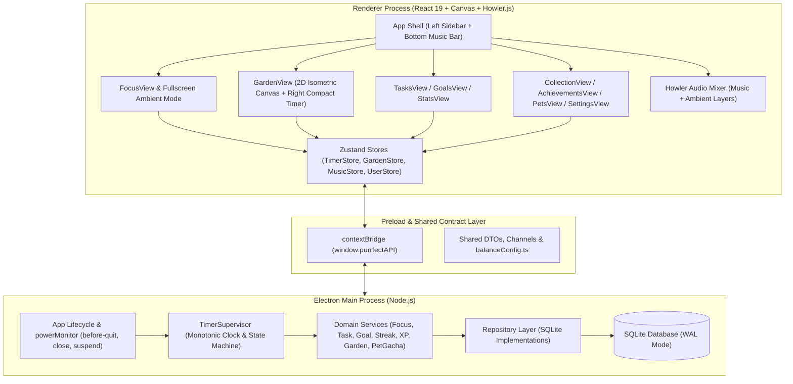

# System Architecture & Module Boundaries — Purrfect Garden

> **Document Status:** Phase 0 Architecture Specification  
> **Primary Product Reference:** [PURRFECT_GARDEN_PRD.md](../PURRFECT_GARDEN_PRD.md)

---

## 1. Architectural Principles

1. **Strict Process Isolation:** All SQLite file access, domain rule validation, monotonic timer authority, and OS lifecycle hooks live in the **Electron Main Process**. The **Renderer Process** is strictly a presentation and audio-playback layer communicating through a typed `contextBridge` API.
2. **Local-First, Cloud-Ready Repository Abstraction:** Domain services depend on TypeScript repository interfaces (`IFocusRepository`, `IGardenRepository`, etc.), never directly on SQLite driver calls. Introducing cloud sync later only requires adding a sync adapter or repository decorator without rewriting domain logic.
3. **Timer Independence from Rendering:** Timer calculations never rely on React render loops or `setInterval` tick counts.
4. **Data-Driven Game Balancing:** Unfinalized PRD constants (XP formulas, item prices, streak minimums, gacha rates) live in `src/shared/config/balanceConfig.ts` and database definition catalogs.

---

## 2. Layered System Architecture



---

## 3. Proposed Repository Directory Structure

```text
Purrfect Garden/
├── docs/
│   ├── PURRFECT_GARDEN_PRD.md
│   └── architecture/
│       ├── AGENT_WORKFLOW.md
│       ├── DATABASE_DESIGN.md
│       ├── DEVELOPMENT_ROADMAP.md
│       ├── SYSTEM_ARCHITECTURE.md
│       └── TECH_STACK.md
├── assets/                          # Original / licensed pixel sprites & audio
│   ├── sprites/
│   │   ├── tiles/                   # Isometric ground & path tiles
│   │   ├── plants/                  # Seeds & plant growth stages / collectibles
│   │   ├── tools/                   # Tools & technologies icons/sprites
│   │   ├── pets/                    # Cats, Dogs, Capybaras (no bears)
│   │   └── ui/                      # Pixel UI badges & frames
│   └── audio/
│       ├── music/                   # Lo-fi & piano tracks
│       └── ambience/                # Rain, fireplace, forest, ocean waves
├── src/
│   ├── shared/                      # Shared across Main, Preload & Renderer
│   │   ├── config/
│   │   │   └── balanceConfig.ts     # Configurable XP, Pomodoro, streak & gacha defaults
│   │   ├── constants/
│   │   │   └── ipcChannels.ts       # Strongly typed IPC channel constants
│   │   └── types/                   # Domain DTOs, API interfaces, Enums
│   │       ├── timer.ts
│   │       ├── task.ts
│   │       ├── goal.ts
│   │       ├── garden.ts
│   │       ├── pet.ts
│   │       └── api.ts
│   ├── preload/
│   │   └── index.ts                 # Exposes window.purrfectAPI via contextBridge
│   ├── main/
│   │   ├── index.ts                 # Electron entry, window lifecycle & powerMonitor
│   │   ├── ipc/                     # IPC handler registrations per domain
│   │   ├── database/
│   │   │   ├── connection.ts        # better-sqlite3 init (WAL, foreign_keys=ON)
│   │   │   ├── migrator.ts          # Ordered SQL migration runner
│   │   │   └── migrations/          # 001_initial.sql, etc.
│   │   ├── repositories/            # Repository interfaces + SQLite implementations
│   │   └── services/                # Pure business logic & transaction orchestration
│   │       ├── TimerSupervisor.ts
│   │       ├── FocusSessionService.ts
│   │       ├── TaskService.ts
│   │       ├── GoalService.ts
│   │       ├── StreakService.ts
│   │       ├── ProgressionService.ts
│   │       ├── AchievementService.ts
│   │       ├── GardenService.ts
│   │       └── PetGachaService.ts
│   └── renderer/
│       ├── main.tsx
│       ├── App.tsx
│       ├── stores/                  # Zustand state slices
│       ├── services/
│       │   └── audioEngine.ts       # Howler.js music & multi-layer ambience mixer
│       ├── engine/                  # 2D Isometric Canvas math, renderer & depth sort
│       ├── components/              # Shared cozy UI components & Sidebar / MusicBar
│       └── views/                   # FocusView, GardenView, TasksView, etc.
└── tests/
    ├── unit/                        # Timer, Streak, XP, Goal, Isometric math tests
    └── integration/                 # SQLite transaction & repository tests (:memory:)
```

---

## 4. Navigation & Screen Layout Design

### 4.1. Persistent Desktop Frame
- **Left Sidebar Navigation (10 PRD Sections):**
  1. `Focus` (Default home view)
  2. `Garden`
  3. `Tasks`
  4. `Goals`
  5. `Achievements`
  6. `Collection`
  7. `Pets`
  8. `Music`
  9. `Statistics`
  10. `Settings`
  - Sidebar footer displays live **Current Streak** and **XP Balance**.
- **Bottom Ambient Music Bar:** Persistent mini-player for play/pause, master volume, playlist quick-switch, and quick toggle of ambient layers.

### 4.2. Primary Screens
- **Focus Screen (Default):**
  - Centered, distraction-free timer card (Mode selector: `Pomodoro` | `Stopwatch` | `Custom`, large readable countdown/count-up display, Start / Pause / Resume / Stop / Reset / Skip Break buttons).
  - Soft, low-contrast miniature preview of the user's active garden behind or alongside the focus card so it never competes visually with the timer.
  - Optional linked task selector & compact daily progress summary (Today's Focus Minutes, Active Daily Goals).
  - **Fullscreen Ambient Mode:** Expands timer and gentle cozy backdrop, hides sidebar/chrome, provides minimal playback controls.
- **Garden Screen:**
  - Main viewport hosts the **2D Isometric Pixel-Art Diorama Canvas** (bright, soft cozy palette; tile placement/move/remove controls; garden area switcher; collapsible inventory tray).
  - **Right-Side Docked Timer Panel:** Persistent compact timer panel anchored on the right side so users can start, pause, resume, or stop a focus session without leaving the Garden view (PRD Section 4.7 & Section 19).

---

## 5. Module Boundaries & Core Interfaces

### 5.1. Timer Supervisor Contract (`src/shared/types/timer.ts`)

```typescript
export type TimerMode = 'pomodoro' | 'stopwatch' | 'custom';
export type TimerPhase = 'focus' | 'short_break' | 'long_break';
export type TimerStatus = 'idle' | 'running' | 'paused';

export interface TimerStateSnapshot {
  sessionId: string | null;
  mode: TimerMode;
  phase: TimerPhase;
  status: TimerStatus;
  targetDurationSeconds: number | null; // null for stopwatch
  elapsedSeconds: number;               // computed monotonically
  pomodoroCycleIndex: number;
  linkedTaskId: string | null;
  startedAtIso: string | null;
  pendingRecovery: boolean;             // true if restored paused after restart
}

export interface ITimerSupervisor {
  getSnapshot(): TimerStateSnapshot;
  start(options: { mode: TimerMode; targetSeconds?: number; taskId?: string | null }): TimerStateSnapshot;
  pause(reason: 'user' | 'app_exit' | 'system_suspend'): TimerStateSnapshot;
  resume(): TimerStateSnapshot;
  stopAndSave(): Promise<FocusCompletionResult>;
  reset(): TimerStateSnapshot;
  skipPhase(): TimerStateSnapshot;
  restoreInterruptedSession(): TimerStateSnapshot | null;
}
```

### 5.2. Preload IPC Bridge Contract (`src/shared/types/api.ts`)

```typescript
export interface PurrfectAPI {
  timer: {
    getState(): Promise<TimerStateSnapshot>;
    start(input: StartTimerInput): Promise<TimerStateSnapshot>;
    pause(): Promise<TimerStateSnapshot>;
    resume(): Promise<TimerStateSnapshot>;
    stop(): Promise<FocusCompletionResult>;
    reset(): Promise<TimerStateSnapshot>;
    skipPhase(): Promise<TimerStateSnapshot>;
    onTick(callback: (snapshot: TimerStateSnapshot) => void): () => void;
    onSessionCompleted(callback: (result: FocusCompletionResult) => void): () => void;
  };
  focusHistory: {
    listSessions(filter: SessionFilter): Promise<FocusSessionDTO[]>;
    getSummary(localDate: string): Promise<FocusStatsSummary>;
    getHeatmap(startDate: string, endDate: string): Promise<DailyActivityDTO[]>;
    linkTask(sessionId: string, taskId: string | null): Promise<void>;
  };
  tasks: {
    list(filter?: TaskFilter): Promise<TaskDTO[]>;
    create(input: CreateTaskInput): Promise<TaskDTO>;
    update(id: string, patch: UpdateTaskInput): Promise<TaskDTO>;
    delete(id: string): Promise<void>;
  };
  goals: {
    getActive(localDate: string): Promise<GoalInstanceDTO[]>;
    getStreak(): Promise<StreakStateDTO>;
  };
  progression: {
    getBalance(): Promise<number>;
    getInventory(): Promise<InventoryItemDTO[]>;
    exchangeItem(itemId: string, quantity: number): Promise<ExchangeResult>;
    getAchievements(): Promise<AchievementProgressDTO[]>;
  };
  garden: {
    listAreas(): Promise<UserGardenDTO[]>;
    getLayout(gardenId: string): Promise<GardenPlacementDTO[]>;
    placeItem(input: PlaceItemInput): Promise<GardenPlacementDTO>;
    moveItem(placementId: string, tileX: number, tileY: number): Promise<void>;
    removeItem(placementId: string): Promise<void>;
  };
  pets: {
    listOwned(): Promise<UserPetDTO[]>;
    rollGacha(currency: 'ticket' | 'xp', count: 1 | 10): Promise<GachaRollResult>;
    placePet(userPetId: string, gardenId: string, tileX: number, tileY: number): Promise<void>;
  };
  settings: {
    getAll(): Promise<AppSettingsBundle>;
    update(patch: Partial<AppSettingsBundle>): Promise<AppSettingsBundle>;
  };
}
```

---

## 6. Technical Risks & Architectural Mitigations

### Risk 1: Timer Drift and UI Throttling
- **Problem:** Electron Renderer timers (`setInterval`) are throttled when minimized or occluded, and `setInterval` drifts over 25–90 minute focus sessions.
- **Mitigation:**
  - `TimerSupervisor` lives in the **Main Process** (never throttled like background browser tabs).
  - Active elapsed time is computed dynamically using Node's monotonic clock (`process.hrtime.bigint()` or `performance.now()`) anchored at each resume event:
    $$\text{totalElapsedMs} = \text{accumulatedMs} + (\text{monotonicNow} - \text{resumedAtMonotonic})$$
  - Periodic 250ms broadcasts push updated snapshots to the UI solely for display rendering.

### Risk 2: App Exit, Crash, or OS Sleep During Active Focus
- **Problem:** User closes the window, quits via tray/taskbar, or puts Windows to sleep while a focus session is running. PRD Section 4.3 strictly prohibits counting closed/background time and requires restoring the session as paused.
- **Mitigation:**
  - When a session starts or resumes, Main immediately inserts/updates a `focus_sessions` row with `status = 'active'`.
  - Every 15 seconds (checkpoint), Main updates `last_checkpoint_seconds` in SQLite.
  - On `mainWindow.on('close')`, `app.on('before-quit')`, and `powerMonitor.on('suspend')`, `TimerSupervisor.pause('app_exit' | 'system_suspend')` runs **synchronously** inside `better-sqlite3`, persisting exact `recorded_seconds` and setting `status = 'paused'`.
  - On startup, `restoreInterruptedSession()` checks for any row in `focus_sessions` with `status IN ('active', 'paused')`:
    - If found as `'active'` (e.g., abnormal process kill), it recovers using `last_checkpoint_seconds` (never extrapolating wall-clock time past the checkpoint!) and transitions it to `'paused'`.
    - Loads the session into `TimerSupervisor` in `paused` state (`pendingRecovery = true`), letting the user explicitly **Resume** or **Finish/Stop**.

### Risk 3: Local Data Corruption & Economy Race Conditions
- **Problem:** Double-clicking "Claim Reward", purchasing an item twice simultaneously, or losing power mid-write could create negative XP, duplicate one-time rewards, or corrupt database state.
- **Mitigation:**
  - Enable `PRAGMA journal_mode = WAL;` and `PRAGMA foreign_keys = ON;`.
  - Wrap all multi-table mutations in synchronous `db.transaction(...)` blocks.
  - Enforce SQLite `CHECK (balance_after >= 0)` on `xp_transactions` and `UNIQUE` constraints on `goal_instances` / `user_achievements` reward claims.

### Risk 4: Blurry or Misaligned 2D Isometric Pixel Art
- **Problem:** Fractional scaling or floating-point canvas coordinates cause blurry sprites ("pixel swimming") and z-order flickering in isometric scenes.
- **Mitigation:**
  - Use standard **2:1 isometric projection** (e.g., `64×32` base tile size):
    - `screenX = Math.round((tileX - tileY) * (TILE_W / 2))`
    - `screenY = Math.round((tileX + tileY) * (TILE_H / 2))`
  - Lock camera zoom to integer multipliers (`1x`, `2x`, `3x`) with `ctx.imageSmoothingEnabled = false`.
  - Sort renderables each frame via deterministic painter's key: `(tileX + tileY, layerPriority, tileX)`.
  - Ensure all sprite assets adhere to a shared pixel density grid and origin anchor (`bottom-center` of tile footprint).

